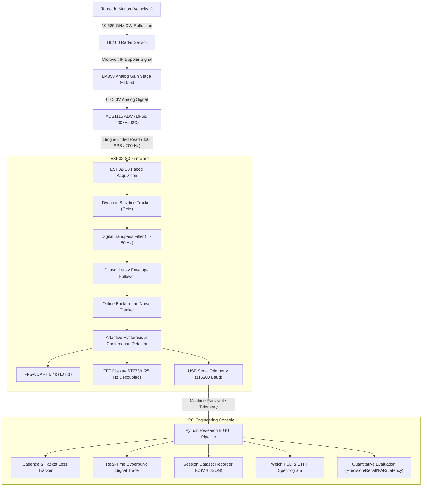

# ARGUS-EYE System Architecture & Technical Specification

## 1. System Overview

ARGUS-EYE is a continuous-wave (CW) microwave Doppler radar motion-detection and research system designed around an HB100 sensor (10.525 GHz), LM358 analog amplifier, ADS1115 external delta-sigma ADC, ESP32-S3 dual-core microcontroller, and a high-performance Python PC engineering console.

---

## 2. Doppler Radar Signal Physics

### 2.1 Doppler Shift Derivation
The HB100 continuous-wave transmitter emits microwave radiation at nominal carrier frequency:
$$f_0 = 10.525 \text{ GHz} \quad (\lambda_0 \approx 2.85 \text{ cm})$$

When an illuminated target moves with radial velocity $v$ relative to the radar aperture:
$$f_d = \frac{2 \cdot v \cdot f_0}{c} = \frac{2 \cdot v}{\lambda_0}$$

Where $c \approx 2.9979 \times 10^8 \text{ m/s}$. The Doppler scale factor is:
$$\frac{f_d}{v} \approx 70.22 \text{ Hz per (m/s)}$$

### 2.2 Operational Velocity & Doppler Bandwidth
| Target Motion Type | Radial Velocity ($v$) | Expected Doppler Shift ($f_d$) | ADS1115 Nyquist Feasibility |
|---|---|---|---|
| Subtle chest breathing | $0.01 - 0.05 \text{ m/s}$ | $0.7 - 3.5 \text{ Hz}$ | Sub-band (requires high gain) |
| Hand gesture / waving | $0.2 - 0.6 \text{ m/s}$ | $14 - 42 \text{ Hz}$ | Fully captured at 200 Hz |
| Normal human walking | $0.8 - 1.4 \text{ m/s}$ | $56 - 98 \text{ Hz}$ | Fully captured at 200 Hz |
| Running / arm swing | $1.8 - 2.5 \text{ m/s}$ | $126 - 175 \text{ Hz}$ | Requires 400+ Hz sampling |

---

## 3. Hardware & Acquisition Pipeline

### 3.1 ADS1115 External ADC Optimization
The Texas Instruments ADS1115 is a 16-bit delta-sigma ADC with programmable gain and data rate options (128, 250, 475, and 860 SPS).
- **Previous Bottleneck:** Running at default 128 SPS with 100 kHz I2C and blocking SPI screen redraws on every sample choked the acquisition loop to $\sim 40\text{ Hz}$, distorting Doppler frequencies above 20 Hz.
- **Improved Pipeline:**
  1. **I2C Clock:** Boosted to 400 kHz fast mode (`Wire.setClock(400000)`).
  2. **ADC Conversion Rate:** Configured to `RATE_ADS1115_860SPS` ($\sim 1.16 \text{ ms}$ conversion time).
  3. **Paced Sampling:** Paced using hardware microsecond timer (`micros()`) at nominal interval $\Delta t = 5000\ \mu\text{s}$ ($200\text{ Hz}$ nominal cadence).
  4. **Decoupled Visuals:** TFT visual updates and FPGA UART transfers run asynchronously at 25 Hz and 10 Hz respectively, eliminating SPI blocking in the acquisition-critical path.

---

## 4. Signal Processing Algorithms

### 4.1 Dynamic Baseline Tracking
The raw ADC output contains a high-level DC bias ($\sim 1.65\text{V}$ from single-supply LM358 biasing). The baseline is dynamically tracked using an exponential moving average (EMA):
$$B[n] = (1 - \alpha_{\text{base}}) \cdot B[n-1] + \alpha_{\text{base}} \cdot X[n]$$
where $\alpha_{\text{base}} = 0.01$. The signed AC Doppler signal is:
$$S[n] = X[n] - \text{round}(B[n])$$

### 4.2 Causal Bandpass Filter
A cascaded 1st-order DC-blocking high-pass filter ($f_c \approx 4\text{ Hz}$) and anti-aliasing low-pass filter ($f_c \approx 80\text{ Hz}$) isolates the Doppler signal:
$$y_{\text{HP}}[n] = \alpha_{\text{HP}} \cdot (y_{\text{HP}}[n-1] + X[n] - X[n-1]) \quad (\alpha_{\text{HP}} = 0.888)$$
$$y_{\text{LP}}[n] = y_{\text{LP}}[n-1] + \beta_{\text{LP}} \cdot (y_{\text{HP}}[n] - y_{\text{LP}}[n-1]) \quad (\beta_{\text{LP}} = 0.715)$$

### 4.3 Causal Leaky Envelope Follower
To prevent spurious zero-crossing triggers within each Doppler oscillation cycle:
$$\text{Env}[n] = \begin{cases}
\alpha_{\text{att}} \cdot |y_{\text{LP}}[n]| + (1 - \alpha_{\text{att}}) \cdot \text{Env}[n-1] & \text{if } |y_{\text{LP}}[n]| > \text{Env}[n-1] \\
\alpha_{\text{dec}} \cdot |y_{\text{LP}}[n]| + (1 - \alpha_{\text{dec}}) \cdot \text{Env}[n-1] & \text{if } |y_{\text{LP}}[n]| \le \text{Env}[n-1]
\end{cases}$$
with attack factor $\alpha_{\text{att}} = 0.35$ and decay factor $\alpha_{\text{dec}} = 0.05$.

### 4.4 Adaptive Noise Floor & Hysteresis Detector
- **Quiet Noise Tracking:** During inactive states, the ambient noise floor $\sigma_{\text{noise}}$ is estimated using a slow asymmetric tracker ($\alpha_{\text{noise}} = 0.002$).
- **Trigger Threshold:** $T_{\text{trig}} = \max(T_{\text{min}}, 2.5 \cdot \sigma_{\text{noise}} + 10)$.
- **Release Threshold:** $T_{\text{rel}} = T_{\text{trig}} \cdot 0.65$.
- **Persistence Confirmation:** Requires $N_{\text{confirm}} = 3$ consecutive samples above $T_{\text{trig}}$ ($\sim 15\text{ ms}$) to reject brief electrical glitches.
- **Hold-Off Timer:** Once triggered, state remains asserted for $N_{\text{hold}} = 30$ samples ($\sim 150\text{ ms}$) after envelope drops below $T_{\text{rel}}$, merging micro-flutter into continuous events.
